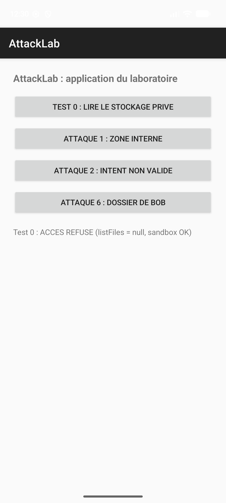
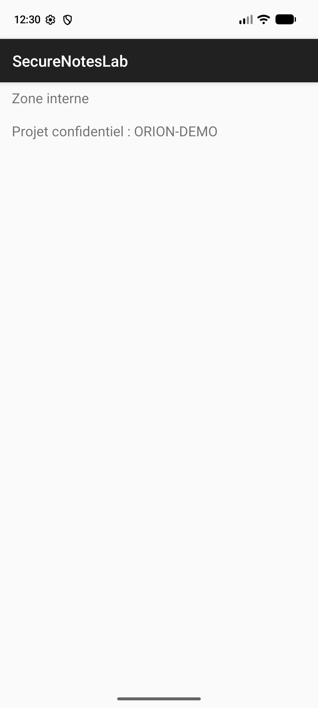
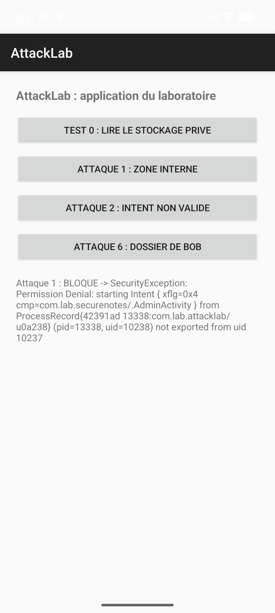
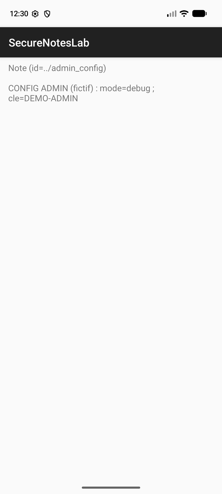
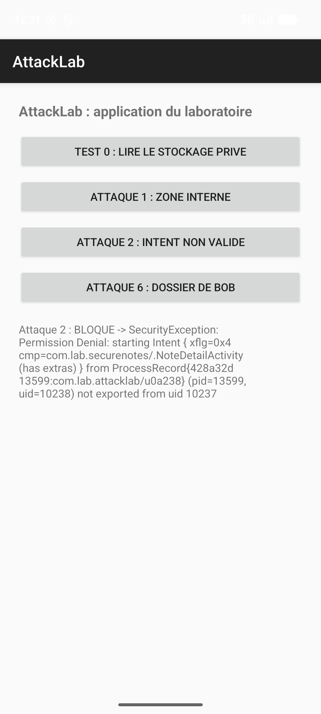
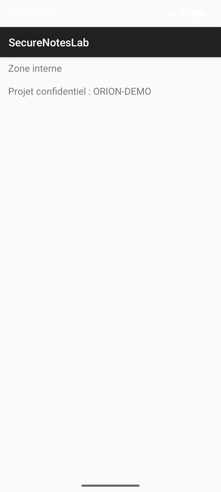
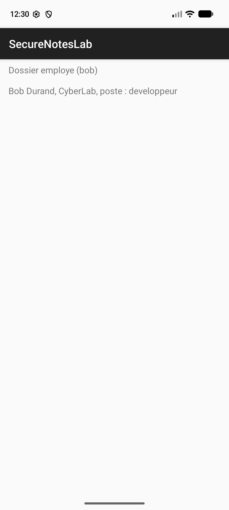
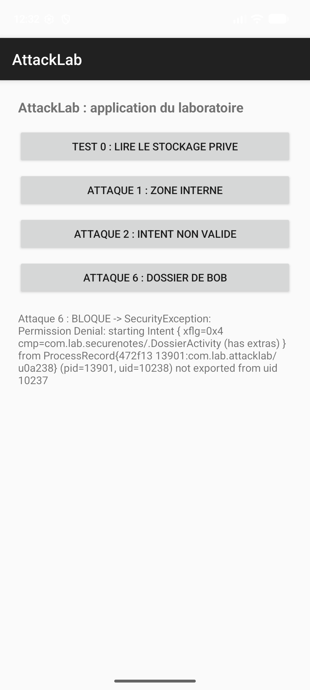

# TP récapitulatif : Attaquer, Comprendre, Corriger, Protéger

Ihab, EIDIA, UEMF Fès. Émulateur Pixel 6a (API 37.2). Application victime : SecureNotesLab (`com.lab.securenotes`). Application attaquante : AttackLab (`com.lab.attacklab`).

## Résultats

| # | Vulnérabilité | Attaque | Correction | Après correction |
|---|---------------|---------|------------|------------------|
| V1 | Activité admin exportée | Lancement de `AdminActivity` depuis AttackLab | `android:exported="false"` | Bloqué (SecurityException) |
| V2 | Traversée de chemin sur `noteId` | `noteId=../admin_config` | Liste blanche des identifiants | Bloqué |
| V3 | Jeton dans les logs | Lecture de logcat | Suppression du `Log.d` | Aucun jeton dans logcat |
| V4 | Clé API en dur | Recherche dans `classes.dex` | Suppression de la constante | Clé introuvable |
| V5 | Jeton en clair dans SharedPreferences | `run-as cat session_prefs.xml` | AES-GCM + AndroidKeyStore | Valeur chiffrée |
| V6 | Pas de contrôle d'autorisation (IDOR) | Ouverture du dossier de Bob | Comparaison de l'utilisateur courant avec l'id demandé | Bloqué |

## Test 0 : isolation Android

AttackLab essaie de lister `/data/data/com.lab.securenotes/` avec `run-as` : Android répond « Permission denied », avant comme après correction. L'isolation fonctionne : les attaques suivantes réussissent parce que l'application expose des composants ou des secrets, pas à cause d'une faille d'Android.

## V1 : activité exportée

Attaque : AttackLab lance `AdminActivity` et obtient « Projet confidentiel : ORION-DEMO ».
Impact : accès à l'écran admin sans authentification.
Correction : `android:exported="false"` sur `AdminActivity` (et sur `NoteDetailActivity`, `DossierActivity`).
Après : `SecurityException: not exported from uid 10237`.

## V2 : traversée de chemin

Attaque : `noteId=../admin_config` affiche « CONFIG ADMIN (fictif) ».
Impact : lecture de fichiers internes non prévus.
Correction : `noteId` accepté seulement s'il est dans `setOf("note_alice_01")`.

## V3 : fuite dans les logs

Attaque : logcat contient `demo_token_7A91` après l'authentification.
Impact : tout outil de débogage récupère le jeton de session.
Correction : le jeton n'est plus écrit dans `Log.d`. Logcat affiche seulement « Authentification terminee ».

## V4 : secret en dur

Attaque : `DEMO-KEY-12345` retrouvé dans `classes.dex`.
Impact : toute personne ayant l'APK obtient la clé.
Correction : `const val API_KEY` supprimée de `Session.kt`.
Preuves : `evidence/avant/A4_apk.txt`, `evidence/apres/A4_apk.txt`.

## V5 : jeton en clair

Attaque : `run-as ... cat shared_prefs/session_prefs.xml` montre le jeton.
Impact : jeton lisible sur un appareil débogable ou rooté.
Correction : chiffrement AES-GCM, clé dans AndroidKeyStore (`ChiffrementKeystore.kt`).
Preuves : `evidence/avant/A5_prefs.txt`, `evidence/apres/A5_prefs.txt`.

## V6 : accès au dossier d'un autre utilisateur

Attaque : AttackLab ouvre `DossierActivity` avec l'id de Bob et affiche son fichier.
Impact : accès aux données d'un autre employé.
Correction : `DossierActivity` compare `SessionUtilisateur.idActuel` à `employeId`, sinon « Acces refuse ».

## Remarques

- Sur cet émulateur, `adb shell am start` est aussi refusé pour un composant non exporté (SecurityException depuis l'uid 2000), contrairement au message du guide (« Activity class does not exist »).
- Après correction, V2 et V6 sont bloquées par `exported="false"` avant d'atteindre le code : la liste blanche et le contrôle d'autorisation n'ont pas été testés par l'attaque externe. Le résultat « bloqué » signifie seulement que le scénario testé échoue.